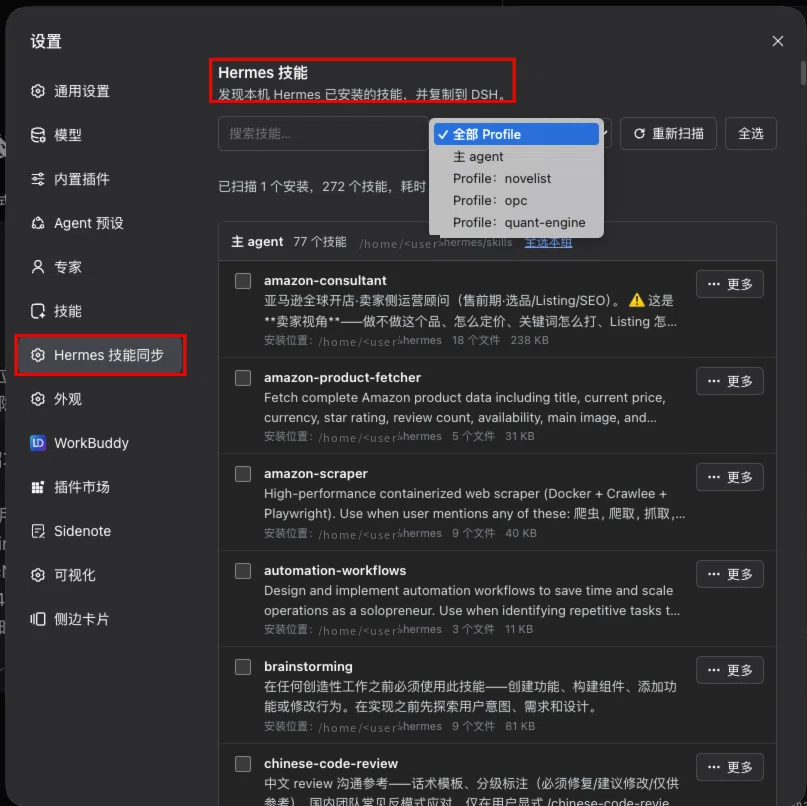
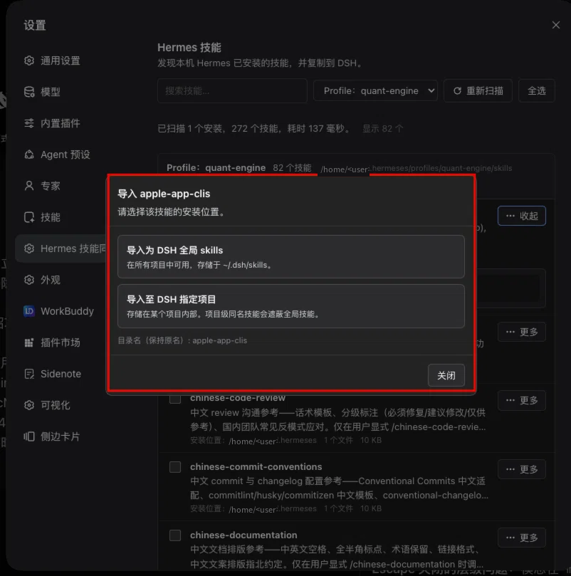
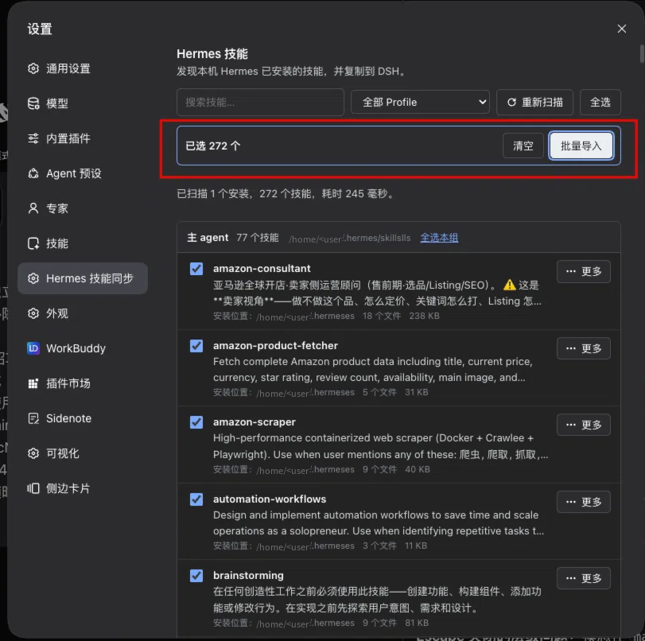

# hermes-skills-sync


> 把本机 Hermes 已安装的技能，一键搬进 DeepSeek Harness。
> Bring the skills Hermes installed on this machine into DeepSeek Harness.

[](LICENSE)
[](https://github.com/deepseek-ai)

一个面向 [DeepSeek Harness](https://github.com/deepseek-ai)（以下简称 DSH）的 Cordis 插件（Host + Client 双半边）。
它在本机扫描 Hermes Agent 的技能目录，把其中的技能复制为 DSH 的**全局技能**或**项目级技能**，
不需要手工搬运文件、不需要改写目录结构、也不会覆盖你已有的同名技能。

A Cordis bundle (Host + Client halves) for DeepSeek Harness. It scans the Hermes Agent
skill directories on this machine and copies a selected skill into DSH — either as a
**global skill** or as a **project skill**. No manual file juggling, no directory
renaming, and never a silent overwrite of an existing skill.

---

## 目录 / Contents

- [截图 / Screenshots](#截图--screenshots)
- [功能 / Features](#功能--features)
- [优势 / Why](#优势--why)
- [安装 / Installation](#安装--installation)
- [使用 / Usage](#使用--usage)
- [实现逻辑 / How it works](#实现逻辑--how-it-works)
- [HTTP 接口 / HTTP API](#http-接口--http-api)
- [目录结构 / Repository layout](#目录结构--repository-layout)
- [测试 / Tests](#测试--tests)
- [文档 / Documents](#文档--documents)
- [许可 / License](#许可--license)

---

## 截图 / Screenshots

### 1. 按 Hermes Profile 筛选

设置面板中的 **Hermes 技能同步** 分区。下拉框列出本机发现的所有 Hermes Profile
（主 agent 与各个 profile），可把 272 个技能收敛到关心的那一组。

The **Hermes Skills Sync** section in the Settings panel. The dropdown lists every Hermes
profile discovered on this machine (the main agent plus each profile), so a few hundred
skills collapse down to the group you actually care about.



### 2. 导入目标选择

点「更多 → 导入到 DSH」，先选**全局**还是**指定项目**；选项目时可以直接挑 DSH 已注册的
工作区，也可以通过宿主目录选择器任选一个本机目录作为项目根。

Pick **global** or **a specific project**. For a project you can choose one of the
workspaces DSH already knows about, or pick any folder on this machine as the project
root through the host directory picker.



### 3. 批量导入

勾选多个技能后批量导入：顶部显示已选数量与被筛选隐藏的数量，工具栏「全选」作用于
**当前筛选后的可见集合**（与搜索、Profile 筛选叠加），导入过程有进度条，完成后给出
「新增 / 替换 / 失败」汇总，失败项可单独重试。

Select several skills and import them in one go: the toolbar counts what is selected and
what the current filter hides, “Select all” applies to the **currently visible** set
(composed with the search box and the profile filter), and the run reports
new / replaced / failed with a retry button for the failures.



---

## 功能 / Features

| 功能 | 说明 |
| --- | --- |
| **多源发现** | 自动探测本机所有 Hermes 安装：`~/.hermes`、`~/.config/hermes`、`~/.local/share/hermes`、`~/.hermes-agent`、`/opt/hermes`、`/usr/local/hermes`、`/usr/lib/hermes`；也可用环境变量 `DSH_HERMES_HOME` 指定。每个路径独立探测，多处安装会被全部列出。 |
| **Profile 分组** | 区分主 agent 与 `profiles/` 下的各个 profile，每个 profile 单独一组，界面可按组筛选。 |
| **分类目录识别** | Hermes 用「目录套目录」的方式给技能分组。插件能区分「真技能」（目录内有 `SKILL.md`）与「分类容器」（只有子技能，没有 `SKILL.md`），后者只做分组展示，不会被误当成可导入的技能。 |
| **Frontmatter 解析** | 自带一个只解析所需 YAML 子集的 frontmatter 解析器（不引入任何第三方 YAML 依赖），能处理引号值、块标量 `|`/`>` 与简单列表；解析失败不会中断扫描。 |
| **两级导入** | 导入为 DSH **全局技能**（`$DSH_HOME/skills/`）或导入到**指定项目**（`<project>/.dsh/skills/`），项目级同名技能会遮蔽全局技能。 |
| **保持原名** | 目标目录名保持技能原名（中文、空格、括号都原样保留）。DSH 从不校验目录名，只有 `SKILL.md` frontmatter 里的 `name:` 受 kebab-case 约束。 |
| **可选规范化** | 当 frontmatter 的 `name:` 不符合 kebab-case 时，插件可**只改写这一行**，并把原值以 `# original-name:` 注释保留。默认开启，导入对话框里可以关掉以获得逐字节一致的副本。 |
| **冲突处理** | 导入前调用 `/conflicts` 预检；命中冲突时弹出对话框让你选 **覆盖 / 重命名 / 跳过**，绝不静默覆盖。批量导入可以对整批统一选择策略（全部覆盖 / 全部重命名并追加 `-2`、`-3` 后缀 / 全部跳过）。 |
| **批量导入** | 单批上限 500 项，服务端并发 4；每项独立复制，单项失败不中断整批；批量端点不可用时（例如 Host 未重启）客户端自动降级为并发 4 的单条导入。 |
| **项目目标兜底** | 项目列表优先取自 DSH 工作区注册表；注册表为空时仍可通过宿主目录选择器任选目录，不会走进死胡同。 |
| **响应式布局** | 窄屏（< 768px）列表行纵向堆叠成卡片、弹窗变成底部抽屉；1280px 屏 200% 缩放（≈640 CSS px）同样落在卡片形态，不产生横向滚动条。 |
| **主题自适应** | 全部样式只引用 `--dsw-alias-*` 主题 token，明暗主题由宿主的 `data-ds-dark-theme` 切换，插件无需自己实现暗色分支。 |
| **无障碍** | `role="dialog"` + `aria-modal`、焦点陷阱、Escape 关闭、焦点归还触发元素、`aria-expanded` / `aria-label` / `role="status"` 等。 |
| **中英双语** | 界面文案内置 `zh` / `en` 两套字典，可随宿主语言切换。 |

---

## 优势 / Why

**相对手工复制文件：**

- **不改名、不丢信息。** 手工复制时，把中文技能目录拖进 `~/.dsh/skills/` 很容易在 DSH 的技能列表里「消失」——因为 DSH 会丢弃 frontmatter `name:` 不合法的技能。这个插件会明确告诉你哪些技能会被 DSH 忽略，并让你决定要不要改写那一个字段。
- **先查冲突再动手。** 覆盖同名技能是事故高发区。插件在真正写盘之前先做一次冲突预检，把选择权交回给人。
- **原子写入。** 复制过程先落到同级的临时目录再 `rename` 就位，失败不会留下半个技能。
- **批量可用。** 几百个技能逐个点不现实，勾选 + 批量导入 + 失败重试是实际工作流的形状。
- **可审计。** 每个技能都显示安装位置、文件数、体积，以及「会以什么名字被导入」。

**相对通用文件同步工具：**

- **懂 Hermes 的目录约定。** 分类容器、profile 结构、`SKILL.md` 约定都是按 Hermes 的真实布局处理的，不是靠扩展名猜。
- **懂 DSH 的加载规则。** 目标目录是 `$DSH_HOME/skills/` 还是 `<project>/.dsh/skills/`，项目级遮蔽全局级的规则，都按宿主实际行为实现。
- **双半边、零依赖。** 插件自身没有任何 npm 依赖，Host 半边用 Node 内置模块直接操作文件系统，Client 半边只用宿主提供的 React 与 slot 机制。

---

## 安装 / Installation

### 环境要求 / Requirements

- DeepSeek Harness（开发与验证基于 `0.2.x` 系列）
- Node.js 18+
- 本机已安装 Hermes Agent（可选；没装的话插件会提示「未发现 Hermes 安装」）

### 方式一：从源码仓库安装 / Install from this repository

```bash
git clone https://github.com/Hochan666/hermes-skills-sync.git
cd hermes-skills-sync
dsh plugin --profile web add "$PWD"
```

也可以直接下载 zip 压缩包后按同样的方式安装：

```bash
# 下载指定版本（当前最新：v1.3.0）
curl -LO https://github.com/Hochan666/hermes-skills-sync/archive/refs/tags/v1.3.0.zip
unzip v1.3.0.zip
dsh plugin --profile web add "$PWD/hermes-skills-sync-1.3.0"
```

或在仓库页面点 **Code → Download ZIP**（默认取默认分支）。

`dsh plugin` 会把剩余参数转发给 profile 目录下的包管理器，因此本地目录会被**链接**进
profile（源码改动即时可见，不需要重新发布）。

### 方式二：在 DSH 插件市场安装 / Install from the plugin market

本包已按 npm 包结构发布。安装后重启 DSH，在 **设置 → 插件市场** 中搜索
`hermes-skills-sync` 即可。

### 方式三：插件管理器 / Via the plugin manager

在 DSH 的插件管理器里直接添加本地目录：

```
plugin_manager install_bundle <本仓库的绝对路径>
```

### 卸载 / Uninstall

```bash
dsh plugin --profile web remove hermes-skills-sync
# 或
plugin_manager remove_bundle hermes-skills-sync
```

> **注意：** Host 模块只在 DSH 进程启动时加载，Client bundle 才能热更新。
> 改完 `index.js` 后需要「卸载 + 安装」并重启 DSH，改完 `client.js` 只需要刷新浏览器。

---

## 使用 / Usage

1. 打开 **设置 → Hermes 技能同步**。
2. 页面会自动扫描本机 Hermes 安装，列出主 agent 与各 profile 的技能。
3. 用搜索框过滤名称/描述，用 Profile 下拉框收敛到一组。
4. 单个导入：点「更多 → 导入到 DSH」，选全局或指定项目，确认。
   批量导入：勾选多个技能（或点「全选本组」/ 工具栏「全选」），点「批量导入」。
5. 若目标位置已有同名技能，会弹出冲突对话框，选择覆盖 / 重命名 / 跳过。
6. 导入完成后提示：全局技能需要 DSH 的 `skill-filesystem` provider 处于启用状态才会出现在技能列表里（这是宿主默认配置，插件不会去改它）。

**环境变量**

| 变量 | 作用 |
| --- | --- |
| `DSH_HERMES_HOME` | 覆盖 Hermes 安装目录的自动探测（优先级最高）。 |
| `DSH_HOME` | DSH 自身的家目录，默认 `~/.dsh`。 |

---

## 实现逻辑 / How it works

插件是标准的 Cordis bundle，由两半组成：

### Host 半边（`index.js`）

负责一切**特权操作**：磁盘扫描与文件复制。Client 半边只负责渲染，从不推断导入结果。

1. **发现（discover）**
   `candidateHermesHomes()` 依次探测候选目录，`looksLikeHermesHome()` 以「目录下是否存在 `skills/` 子目录」作为判据。每个候选**独立探测**，所以一台机器上装了多份 Hermes 会被全部列出，而不是只报第一个。

2. **枚举（scan）**
   `scanHermesHome()` 把一个 Hermes 安装切成若干 group：主 agent 一个 group，`profiles/` 下每个拥有 `skills/` 的目录各一个 group。`collectSkills()` 用**队列 + 深度上限（4 层）**做广度优先遍历，避免深目录把栈压垮；只认「目录内直接含有 `SKILL.md`」为技能，分类容器另作记录。

3. **解析（parse）**
   `parseFrontmatter()` 是一个约 40 行的手写解析器，只支持 Hermes 实际用到的 YAML 子集（`key: value`、引号值、块标量 `|`/`>`、简单列表）。刻意不做完整 YAML：扫描阶段任何格式错误都不允许抛异常中断。`readSkillMeta()` 再兜一层——超过 1 MiB 的文件直接跳过。

4. **命名（name）**
   这里有一个容易踩的坑，插件用两条独立规则处理：
   - **目录名**：DSH 从不校验目录名，所以目标目录**保持原名**。`folderNameFor()` 只替换路径分隔符、NUL 与控制字符，给前导 `.` 加前缀，其余原样保留。
   - **frontmatter `name:`**：DSH 会校验它，`^[a-z0-9]+(-[a-z0-9]+)*$`，不合法就整条丢弃。`toDshDeclaredName()` 在需要时把它转成合规名：拉丁字母走小写连字符化，纯 CJK 或符号走 `skill-<sha256 前 8 位>` 的确定性哈希 slug。改写只发生在 `name:` 这一行，原值以注释保留。

5. **写入（import）**
   `copySkill()` 把技能复制到同级的临时目录 `<target>.hermes-tmp-<ts>`，成功后再 `rename` 就位——**失败不会留下半成品**。批量导入时 `mapLimit()` 以并发 4 的方式处理，单项失败只记录结果码，不中断整批。

6. **冲突（conflict）**
   `checkConflicts()` 在写盘之前比较目标目录里已存在的文件夹名，把命中项交给前端决定策略。策略只有三种：`overwrite`、`rename`、`skip`，没有「静默覆盖」这一项。

### Client 半边（`client.js`）

注册在宿主的 `settings.section` slot 上，不自造外壳。组件用 `window.__ModuleLoader__.load()` 加载 React 工厂，文案走 `ctx.locale.register(NS, { zh, en })` 字典，样式是一段只引用 `--dsw-alias-*` 的内联 CSS。

几个刻意的设计选择：

- **行内展开而不是浮层菜单。** 早期版本用 `position: absolute` + `getBoundingClientRect()` 定位「更多」菜单，结果被设置面板的滚动容器裁掉，用户点了没反应。现在操作面板作为 `flex-basis: 100%` 的**行内子元素**渲染，滚动容器无法裁剪它，窄屏也天然适配。
- **焦点陷阱。** 弹窗打开时记录 `document.activeElement`，关闭后归还；Tab / Shift+Tab 在弹窗内循环；Escape 关闭并阻止冒泡。
- **批量端点降级。** Host 模块只在进程启动时加载，Client bundle 热更新——刚更新完插件会短暂处于「新 Client + 旧 Host」状态。客户端捕获 `/import-batch` 的 404，退化为并发 4 的单条 `/import`，并组装出同样的汇总结构，因此不需要重启就能用。

---

## HTTP 接口 / HTTP API

所有路由都挂在 `/api/hermes-skills-sync` 前缀下。

| 方法 | 路径 | 说明 |
| --- | --- | --- |
| `GET` | `/api/hermes-skills-sync/snapshot` | 扫描结果快照：安装实例 → 分组 → 技能，含名称、描述、文件数、体积、可导入名、声明名是否合法。 |
| `GET` | `/api/hermes-skills-sync/targets` | 可选的项目目标列表（工作区标题、路径、会话数）。 |
| `POST` | `/api/hermes-skills-sync/conflicts` | 预检：给定技能与目标，返回每个技能的文件夹名与是否已存在。 |
| `POST` | `/api/hermes-skills-sync/import` | 导入单个技能。请求体含 `sourcePath` / `sourceName` / `target` / `onConflict` / `renameTo` / `normalizeDeclaredName`。 |
| `POST` | `/api/hermes-skills-sync/import-batch` | 批量导入，单批上限 500，服务端并发 4；返回逐项结果与汇总。 |

`target` 形如 `{ "kind": "global" }` 或 `{ "kind": "project", "projectRoot": "/absolute/path" }`。

---

## 目录结构 / Repository layout

```
hermes-skills-sync/
├── index.js            # Host 半边：发现、解析、导入、冲突预检、HTTP 路由
├── client.js           # Client 半边：设置分区 UI、筛选、批量、冲突对话框
├── cordis.patch.yml    # Loader patch：插入 Host 行
├── locale/
│   ├── en.json         # 插件市场展示元数据（英文）
│   └── zh.json         # 插件市场展示元数据（中文）
├── icon.svg            # 插件图标
├── docs/images/        # README 截图
├── test-host.mjs       # Host 单元测试（72 项断言）
├── test-client.mjs     # Client 交互测试（118 项断言）
├── ARCHITECTURE.md     # 技术方案：接口核验、算法伪代码、主题 token 清单
├── ACCEPTANCE.md       # 验收报告：用例矩阵、实测数据、缺陷与修复记录
├── LICENSE             # PolyForm Noncommercial 1.0.0
└── package.json
```

---

## 测试 / Tests

```bash
npm test          # node test-host.mjs && node test-client.mjs
```

- **Host 侧 72 项断言**：多实例发现、主 agent / Profile 分离、分类目录识别、frontmatter（含块标量与折叠标量）、名称映射规则、全局与项目导入、冲突三策略、失败原子性、越界写入防护、批量导入汇总。
- **Client 侧 118 项断言**：bundle 形状、`inject` 声明、slot 注册、locale 注册、组件渲染、CSS 只用主题 token、响应式断点、底部抽屉、API 接线、无障碍属性、批量选择与降级路径。

测试脚手架是可交互的：逐组件 hook 状态 + 重渲染，能真实模拟点击并断言 DOM 变化。

---

## 文档 / Documents

- [`ARCHITECTURE.md`](ARCHITECTURE.md) —— 前端技术方案：Host/Client 两侧的接口核验来源、扫描与分类算法伪代码、DSH 命名规则的实测结论、完整的主题 token 清单。
- [`ACCEPTANCE.md`](ACCEPTANCE.md) —— 验收报告：沙箱隔离方案、用例与实测结果、过程中发现并修复的真实缺陷（含每条缺陷的影响与修法）、已知限制。

---

## 许可 / License

本项目采用 **[PolyForm Noncommercial License 1.0.0](LICENSE)**。

- ✅ 允许：个人使用、研究、实验、教学、非营利组织的使用。
- ❌ 不允许：任何商业用途，也不得将本软件用于任何预期产生商业收益的场景。
- ✅ 允许：修改、衍生作品、重新分发（须保留本许可与 `Required Notice`）。

**Required Notice: Copyright Hochan (https://github.com/Hochan666)**

本软件按「现状」提供，不附带任何明示或默示担保。作者不对使用本软件造成的任何损失承担责任。
如果你需要在商业场景中使用，请先通过
[Issues](https://github.com/Hochan666/hermes-skills-sync/issues) 联系作者取得许可。

---

## 致谢 / Credits

- [DeepSeek Harness](https://github.com/deepseek-ai) —— 插件运行时与 slot / locale / 主题机制。
- [Hermes Agent](https://github.com/NousResearch/hermes-agent) —— 技能目录布局的来源。
